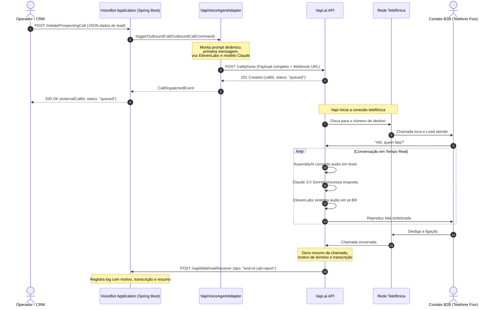

# 🎙️ VAPI Voicebot PoC — Atendente Virtual Ativo B2B

> **Proof of Concept (PoC)** de um agente autônomo de voz para ligações ativas de prospecção B2B (focado em telefones fixos e corporativos), integrando **Spring Boot 3**, **Spring Cloud Function**, **Vapi.ai**, **Anthropic Claude 3.5 Sonnet**, **AssemblyAI** e **ElevenLabs**.

---

## 📋 Sumário

- [1. Visão Geral do Projeto](#1-visão-geral-do-projeto)
- [2. Arquitetura do Sistema](#2-arquitetura-do-sistema)
  - [2.1 Padrão Arquitetural (Hexagonal / Ports & Adapters)](#21-padrão-arquitetural-hexagonal--ports--adapters)
  - [2.2 Diagrama de Arquitetura e Componentes](#22-diagrama-de-arquitetura-e-componentes)
  - [2.3 Diagrama de Sequência (Fluxo de Execução)](#23-diagrama-de-sequência-fluxo-de-execução)
  - [2.4 Stack Tecnológica](#24-stack-tecnológica)
  - [2.5 Estrutura de Diretórios](#25-estrutura-de-diretórios)
- [3. Funcionalidades](#3-funcionalidades)
- [4. Roteiro de Execução e Configuração](#4-roteiro-de-execução-e-configuração)
  - [4.1 Pré-requisitos](#41-pré-requisitos)
  - [4.2 Configuração das Variáveis de Ambiente](#42-configuração-das-variáveis-de-ambiente)
  - [4.3 Compilação e Build](#43-compilação-e-build)
  - [4.4 Expondo a Aplicação para Webhooks (Ngrok)](#44-expondo-a-aplicação-para-webhooks-ngrok)
  - [4.5 Execução da Aplicação](#45-execução-da-aplicação)
- [5. Roteiro de Validação e Testes Práticos](#5-roteiro-de-validação-e-testes-práticos)
  - [5.1 Teste 1: Disparo de Chamada Ativa (Outbound Call)](#51-teste-1-disparo-de-chamada-ativa-outbound-call)
  - [5.2 Teste 2: Monitoramento da Chamada em Tempo Real](#52-teste-2-monitoramento-da-chamada-em-tempo-real)
  - [5.3 Teste 3: Simulação de Webhook de Fim de Chamada](#53-teste-3-simulação-de-webhook-de-fim-de-chamada)
- [6. Troubleshooting e Boas Práticas](#6-troubleshooting-e-boas-práticas)

---

## 1. Visão Geral do Projeto

O **vapi-voicebot-poc** é uma solução de inteligência artificial conversacional por voz desenvolvida para atuar na **prospecção ativa B2B**. 

### O Desafio
Em cenários corporativos, grande parte dos contatos iniciais ocorre via telefones fixos, onde a chamada é frequentemente atendida por secretárias eletrônicas, URAs (menus de autoatendimento) ou recepcionistas.

### A Solução
A aplicação atua como orquestradora entre o sistema de gestão/CRM e a plataforma de voz **Vapi.ai**:
1. Recebe um comando de disparo de chamada com os dados do lead (empresa, telefone fixo, pessoa de contato, objetivo da abordagem).
2. Monta dinamicamente a persona, o prompt do sistema e as instruções do agente de IA.
3. Dispara a chamada telefônica via API REST da Vapi.ai conectada à rede de telefonia (PSTN).
4. O robô conduz a ligação de forma humanizada, detecta desvios (URAs, secretárias eletrônicas) e coleta informações relevantes.
5. Ao término, recebe via **Webhook** o relatório detalhado da ligação contendo motivo de término, transcrição integral e resumo com insights.

---

## 2. Arquitetura do Sistema

### 2.1 Padrão Arquitetural (Hexagonal / Ports & Adapters)

O projeto segue os princípios da **Arquitetura Hexagonal (Clean Architecture)** e **Domain-Driven Design (DDD)**, dividindo-se em:

- **Domínio (`br.com.voicebot.domain`)**:
  - Contém as entidades imutáveis (Records) de comando e evento: `OutboundCallCommand` e `CallDispatchedEvent`.
  - Contém a **Porta de Saída (Output Port)** `VoiceAgentProviderPort`, desacoplando o núcleo de negócio de qualquer provedor específico de telefonia ou voz.
- **Aplicação (`br.com.voicebot.application`)**:
  - Implementa as funções de negócio via **Spring Cloud Function**:
    - `initiateProspectingCall`: Função que recebe o comando, orquestra com o domínio e retorna o evento de chamada despachada.
    - `vapiWebhookReceiver`: Consumidor assíncrono que processa callbacks e relatórios emitidos pela Vapi.ai.
- **Infraestrutura (`br.com.voicebot.infra.vapi`)**:
  - **Adaptador de Saída (Output Adapter)** `VapiVoiceAgentAdapter` que implementa a porta `VoiceAgentProviderPort`.
  - Utiliza o `RestClient` nativo do Spring 6+ para se comunicar com os endpoints da Vapi.ai (`https://api.vapi.ai/call/phone`).
  - Configura o pipeline de áudio multimodal em tempo de execução:
    - **STT (Speech-to-Text)**: AssemblyAI (pt).
    - **LLM (Language Model)**: Anthropic Claude 3.5 Sonnet com Prompt parametrizado.
    - **TTS (Text-to-Speech)**: ElevenLabs Turbo v2.5 com voz em Português do Brasil.

```
+------------------------------------------------------------------------------------+
|                                    APLICAÇÃO                                       |
|                                                                                    |
|   [POST /initiateProspectingCall]              [POST /vapiWebhookReceiver]         |
|                 │                                           │                      |
|                 ▼                                           ▼                      |
|    +─────────────────────────+                 +──────────────────────────+        |
|    | initiateProspectingCall |                 |   vapiWebhookReceiver    |        |
|    |      (Spring Cloud)     |                 |      (Spring Cloud)      |        |
|    +────────────┬────────────+                 +────────────┬─────────────+        |
|                 │                                           │                      |
|                 ▼                                           ▼                      |
|    +─────────────────────────+                 +──────────────────────────+        |
|    | VoiceAgentProviderPort  | <── [Porta]     | Processamento de Eventos |        |
|    +────────────┬────────────+                 | & Extração de Relatório  |        |
|                 │                              +──────────────────────────+        |
+─────────────────┼──────────────────────────────────────────────────────────────────+
                  │ (implementação)
                  ▼
+────────────────────────────────────────────────────────────────────────────────----+
|                                 INFRAESTRUTURA                                     |
|                                                                                    |
|    +─────────────────────────+        HTTPS REST         +────────────────────+    |
|    |  VapiVoiceAgentAdapter  | ────────────────────────> |      Vapi.ai       |    |
|    |      (RestClient)       |                           |  Orquestrador Voz  |    |
|    +─────────────────────────+                           +─────────┬──────────+    |
|                                                                    │               |
|                                                                    ▼               |
|                                                          +────────────────────+    |
|                                                          |  Telefonia / PSTN  |    |
|                                                          |   (Twilio/SIP)     |    |
|                                                          +────────────────────+    |
+------------------------------------------------------------------------------------+
```

---

### 2.2 Diagrama de Arquitetura e Componentes

```mermaid
flowchart TD
    subgraph Client["Cliente / Sistema Externo (CRM / Trigger)"]
        CRM["CRM / ERP / Postman"]
    end

    subgraph SpringApp["Microsserviço Spring Boot (vapi-voicebot-poc)"]
        subgraph AppLayer["Camada de Aplicação (Spring Cloud Function)"]
            F1["initiateProspectingCall\n(Function<OutboundCallCommand, CallDispatchedEvent>)"]
            F2["vapiWebhookReceiver\n(Consumer<Map<String, Object>>)"]
        end

        subgraph DomainLayer["Camada de Domínio"]
            CMD["OutboundCallCommand"]
            EVT["CallDispatchedEvent"]
            PORT["VoiceAgentProviderPort (Interface)"]
        end

        subgraph InfraLayer["Camada de Infraestrutura"]
            ADAPTER["VapiVoiceAgentAdapter\n(Spring RestClient)"]
        end
    end

    subgraph CloudVapi["Ecossistema Vapi.ai Cloud"]
        VAPI_CORE["Vapi Engine (Orquestrador)"]
        STT["Speech-To-Text\n(AssemblyAI pt)"]
        LLM["Large Language Model\n(Anthropic Claude 3.5 Sonnet)"]
        TTS["Text-To-Speech\n(ElevenLabs Turbo v2.5)"]
        TELEPHONY["Provedor SIP / Telefonia\n(Twilio / Vonage)"]
    end

    subgraph Target["Destino"]
        PHONE["Telefone Fixo / Lead B2B"]
    end

    CRM -->|1. POST /initiateProspectingCall| F1
    F1 --> CMD
    F1 --> PORT
    PORT -.-> ADAPTER
    ADAPTER -->|2. POST /call/phone| VAPI_CORE

    VAPI_CORE --> STT
    VAPI_CORE --> LLM
    VAPI_CORE --> TTS
    VAPI_CORE --> TELEPHONY

    TELEPHONY -->|3. Discagem PSTN| PHONE
    VAPI_CORE -->|4. Webhook HTTP POST (end-of-call-report)| F2
```

---

### 2.3 Diagrama de Sequência (Fluxo de Execução)



---

### 2.4 Stack Tecnológica

| Componente | Tecnologia | Versão / Detalhes |
| :--- | :--- | :--- |
| **Linguagem** | Java | 21 (LTS) |
| **Framework Base** | Spring Boot | 3.3.4 |
| **Arquitetura Serverless** | Spring Cloud Function Web | 2023.0.3 |
| **Cliente HTTP** | Spring RestClient | Nativo do Spring Framework 6+ |
| **Orquestrador de Voz** | Vapi.ai | REST API v1 (`/call/phone`) |
| **Reconhecimento de Fala (STT)**| AssemblyAI | Idioma `pt` (Português) |
| **Modelo de Linguagem (LLM)** | Anthropic Claude | `claude-3-5-sonnet-20241022` (Temperatura: 0.3) |
| **Síntese de Voz (TTS)** | ElevenLabs | Modelo `eleven_turbo_v2_5` (Voz em pt-BR) |
| **Gerenciador de Dependências**| Apache Maven | 3.8+ / 3.9+ |

---

### 2.5 Estrutura de Diretórios

```
vapi-voicebot-poc/
├── .env.example                               # Modelo de variáveis de ambiente
├── configurations.txt                         # Scripts auxiliares de ambiente
├── pom.xml                                    # Definição de dependências e build Maven
├── README.md                                  # Documentação completa do projeto
└── src/
    └── main/
        ├── java/
        │   └── br/com/voicebot/
        │       ├── VoiceBotApplication.java   # Classe principal (Spring Boot Main)
        │       ├── application/
        │       │   └── VoiceBotFunctions.java # Definição dos Beans funcionais e Webhook
        │       ├── domain/
        │       │   ├── CallDispatchedEvent.java    # Record de retorno da chamada
        │       │   ├── OutboundCallCommand.java    # Record com dados de entrada
        │       │   └── port/
        │       │       └── VoiceAgentProviderPort.java # Interface (Porta de Saída)
        │       └── infra/
        │           └── vapi/
        │               └── VapiVoiceAgentAdapter.java  # Adaptador REST para a Vapi.ai
        └── resources/
            └── application.yml                # Configurações de aplicação e parâmetros Vapi
```

---

## 3. Funcionalidades

### 1. Iniciação Dinâmica de Chamada Ativa B2B (`initiateProspectingCall`)
- **Endpoint**: `POST /initiateProspectingCall`
- **Injeção de Contexto**: Permite definir por chamada o nome da empresa, número de telefone de destino (formato E.164), responsável a ser contatado e o objetivo customizado do pitch de vendas.
- **Prompt Dinâmico do Agente**:
  - Persona de executivo de prospecção comercial B2B.
  - Regra de ouro para telefone fixo: faz perguntas curtas, objetivas, uma por vez, em português brasileiro coloquial e formal.
  - Tratamento inteligente de secretárias eletrônicas e menus de URA: desliga educadamente se não for possível falar com um atendente humano.

### 2. Pipeline Multimodal de Alta Fidelidade em Português
- **Voz Ultra-realista**: Utiliza o motor `eleven_turbo_v2_5` da ElevenLabs com parâmetros ajustados (`stability: 0.5`, `similarityBoost: 0.75`) para garantir baixa latência e naturalidade sonora.
- **Raciocínio Rápido**: Aciona o `claude-3-5-sonnet-20241022` com baixa temperatura (`0.3`), minimizando alucinações e mantendo o foco estrito no objetivo do contato.

### 3. Recepção e Processamento de Webhooks (`vapiWebhookReceiver`)
- **Endpoint**: `POST /vapiWebhookReceiver`
- Ouve eventos de ciclo de vida emitidos pela Vapi.
- **Relatório Pós-Chamada (`end-of-call-report`)**:
  - Extração de `endedReason` (ex: `customer-ended-call`, `assistant-ended-call`, `voicemail`).
  - Extração do `summary` (resumo executivo do diálogo gerado automaticamente por IA).
  - Extração do `transcript` completo (diálogo integral entre o robô e o interlocutor).

---

## 4. Roteiro de Execução e Configuração

### 4.1 Pré-requisitos

1. **Java Development Kit (JDK)**: Versão 21 ou superior instalada (`java -version`).
2. **Apache Maven**: Versão 3.8+ instalada (`mvn -version`).
3. **Conta no Vapi.ai**:
   - Chave de API privada (**API Key**).
   - Um número de telefone registrado e configurado no painel da Vapi (**Phone Number ID**).
4. **Voz ElevenLabs**:
   - Um `Voice ID` de voz em Português do Brasil gerado ou clonado na ElevenLabs.
5. **Ferramenta de Túnel HTTP**:
   - [ngrok](https://ngrok.com/) ou Cloudflare Tunnel para expor o servidor local para receber os webhooks da Vapi.ai.

---

### 4.2 Configuração das Variáveis de Ambiente

Crie um arquivo `.env` na raiz do projeto ou configure as variáveis no seu sistema/IDE com base no arquivo `.env.example`:

| Variável | Descrição | Exemplo |
| :--- | :--- | :--- |
| `SERVER_PORT` | Porta HTTP da aplicação | `8080` |
| `VAPI_API_KEY` | Chave de API privada do Vapi.ai | `vapi_sec_xxxxxxxxxxxx` |
| `VAPI_PHONE_NUMBER_ID` | UUID do número telefônico no painel Vapi | `9b1deb4d-3b7d-4bad-9bdd-2b0d7b3dcb6d` |
| `VAPI_ELEVENLABS_VOICE_ID` | ID da voz ElevenLabs em português | `21m00Tcm4TlvDq8ikWAM` |
| `VAPI_ANTHROPIC_MODEL` | Modelo Anthropic utilizado pelo Vapi | `claude-3-5-sonnet-20241022` |
| `APP_WEBHOOK_URL` | URL pública da sua aplicação para webhooks | `https://seu-tunel.ngrok-free.app/vapiWebhookReceiver` |

> 💡 **Nota**: O Spring Boot lê as variáveis definidas no ambiente do sistema operacional ou passadas como `-D` na inicialização da JVM.

---

### 4.3 Compilação e Build

Para compilar o código e validar dependências:

```powershell
mvn clean compile
```

Para gerar o arquivo `.jar` executável:

```powershell
mvn clean package -DskipTests
```

O artefato gerado estará em `target/vapi-voicebot-poc-0.0.1-SNAPSHOT.jar`.

---

### 4.4 Expondo a Aplicação para Webhooks (Ngrok)

Para que a Vapi.ai consiga entregar os eventos de finalização da chamada (`end-of-call-report`) ao seu ambiente local:

1. Abra um terminal separado e inicie o túnel:
   ```bash
   ngrok http 8080
   ```
2. Copie a URL pública gerada (exemplo: `https://abcd-1234.ngrok-free.app`).
3. Atualize a variável `APP_WEBHOOK_URL`:
   ```bash
   APP_WEBHOOK_URL=https://abcd-1234.ngrok-free.app/vapiWebhookReceiver
   ```

---

### 4.5 Execução da Aplicação

#### Opção A: Executar via Maven (PowerShell)
```powershell
$env:SERVER_PORT="8080"
$env:VAPI_API_KEY="seu_token_vapi"
$env:VAPI_PHONE_NUMBER_ID="seu_phone_number_id"
$env:VAPI_ELEVENLABS_VOICE_ID="seu_voice_id"
$env:VAPI_ANTHROPIC_MODEL="claude-3-5-sonnet-20241022"
$env:APP_WEBHOOK_URL="https://abcd-1234.ngrok-free.app/vapiWebhookReceiver"

mvn spring-boot:run
```

#### Opção B: Executar via JAR (Java 21)
```powershell
java -jar target/vapi-voicebot-poc-0.0.1-SNAPSHOT.jar
```

A aplicação subirá na porta `8080` e registrará no log as duas funções ativas:
`initiateProspectingCall` e `vapiWebhookReceiver`.

---

## 5. Roteiro de Validação e Testes Práticos

### 5.1 Teste 1: Disparo de Chamada Ativa (Outbound Call)

Envie uma requisição HTTP `POST` para o endpoint `/initiateProspectingCall`.

> ⚠️ **Atenção**: O telefone de destino deve estar no formato internacional **E.164** (ex: `+5511999998888` ou `+551133334444`).

#### Exemplo via cURL (Linux / macOS / Git Bash):
```bash
curl -X POST http://localhost:8080/initiateProspectingCall \
  -H "Content-Type: application/json" \
  -d '{
    "companyName": "Acme Logística Ltda",
    "targetLandlineNumber": "+551130001234",
    "contactPerson": "Diretor de Operações",
    "customPitchObjective": "Apresentar solução de redução de custos de frete em 15% através de automação",
    "metadata": {
      "leadId": "LEAD-9872",
      "campanha": "Q4-Prospeccao-Ativa"
    }
  }'
```

#### Exemplo via PowerShell:
```powershell
$body = @{
    companyName = "Acme Logística Ltda"
    targetLandlineNumber = "+551130001234"
    contactPerson = "Diretor de Operações"
    customPitchObjective = "Apresentar solução de redução de custos de frete em 15% através de automação"
    metadata = @{
        leadId = "LEAD-9872"
        campanha = "Q4-Prospeccao-Ativa"
    }
} | ConvertTo-Json

Invoke-RestMethod -Uri "http://localhost:8080/initiateProspectingCall" -Method Post -ContentType "application/json" -Body $body
```

#### Resposta Esperada (200 OK):
```json
{
  "externalCallId": "8f87b8b2-51a1-432c-8067-1721516eef83",
  "status": "queued",
  "providerName": "VAPI_AI"
}
```

---

### 5.2 Teste 2: Monitoramento da Chamada em Tempo Real

1. **No Telefone de Destino**:
   - O telefone tocará. Ao atender, o robô dirá a primeira frase definida:
     > *"Olá, bom dia! Gostaria de falar com o responsável pelo setor administrativo ou comercial da Acme Logística Ltda, por gentileza."*
   - Converse normalmente em português para testar a naturalidade, capacidade de espera e respostas geradas pelo Claude 3.5 Sonnet.
2. **No Dashboard da Vapi.ai**:
   - Acesse [dashboard.vapi.ai/calls](https://dashboard.vapi.ai/calls).
   - Localize a chamada pelo `externalCallId`.
   - Você poderá acompanhar o áudio em tempo real, latência de STT/LLM/TTS e status da conexão.

---

### 5.3 Teste 3: Simulação de Webhook de Fim de Chamada

Quando a chamada termina, a Vapi.ai despacha um payload para a sua `APP_WEBHOOK_URL`. Você também pode simular manualmente essa chegada para validar o processador local:

#### Requisição de Simulação:
```bash
curl -X POST http://localhost:8080/vapiWebhookReceiver \
  -H "Content-Type: application/json" \
  -d '{
    "message": {
      "type": "end-of-call-report",
      "endedReason": "customer-ended-call",
      "summary": "O cliente confirmou ser o Diretor de Operações e demonstrou interesse em conhecer a redução de custos de frete. Solicitou envio de apresentação por e-mail.",
      "transcript": "Assistente: Olá, bom dia! Gostaria de falar com o responsável pelo setor administrativo ou comercial da Acme Logística Ltda, por gentileza.\nCliente: Pois não, quem fala é o Carlos, sou o diretor de operações.\nAssistente: Olá Carlos! Meu objetivo é apresentar como ajudamos empresas a reduzirem até 15% do custo de frete com automação. Faz sentido agendarmos 10 minutos?\nCliente: Me mande o material por e-mail primeiro, por favor.\nAssistente: Perfeito, anotado! Tenha um ótimo dia."
    }
  }'
```

#### Saída Esperada no Log do Console da Aplicação:
```text
[INFO] b.c.v.application.VoiceBotFunctions : Evento Vapi recebido: end-of-call-report
[INFO] b.c.v.application.VoiceBotFunctions : === RELATÓRIO DE FIM DE CHAMADA ===
[INFO] b.c.v.application.VoiceBotFunctions : Motivo de término: customer-ended-call
[INFO] b.c.v.application.VoiceBotFunctions : Resumo: O cliente confirmou ser o Diretor de Operações e demonstrou interesse em conhecer a redução de custos de frete. Solicitou envio de apresentação por e-mail.
[INFO] b.c.v.application.VoiceBotFunctions : Transcrição: Assistente: Olá, bom dia! Gostaria de falar com o responsável pelo setor administrativo ou comercial da Acme Logística Ltda, por gentileza. ...
```

---

## 6. Troubleshooting e Boas Práticas

| Sintoma / Erro | Possível Causa | Ação de Resolução |
| :--- | :--- | :--- |
| **Status `FAILED` ou `UNKNOWN` no disparo** | `VAPI_API_KEY` inválida ou ausente | Verifique se a chave em `application.yml` ou variável de ambiente possui o prefixo e formato correto fornecido no dashboard Vapi. |
| **Erro 400 Bad Request ao chamar `/call/phone`** | Formato de número inválido ou `phoneNumberId` inexistente | O número deve seguir estritamente a norma E.164 (ex: `+5511...`). O `phoneNumberId` deve corresponder a um número ativo no seu inventário Vapi. |
| **Vapi não entrega o relatório pós-chamada** | `APP_WEBHOOK_URL` inacessível pela internet | Certifique-se de que o túnel `ngrok` está ativo e que o endereço configurado aponta exatamente para `/vapiWebhookReceiver`. |
| **Áudio em inglês ou robótico** | `VAPI_ELEVENLABS_VOICE_ID` incorreto | Certifique-se de que a voz selecionada na ElevenLabs suporta o modelo `eleven_turbo_v2_5` ou multilingual para o português. |
| **Chamada cai ao atender secretária eletrônica** | Comportamento intencional do prompt | O prompt instrui o agente a encerrar a chamada caso atinja URAs ou correio de voz sem opção de atendente. Ajuste a diretriz em `VapiVoiceAgentAdapter` se desejar deixar recados gravados. |

---

## 📄 Licença e Manutenção

Projeto mantido como Prova de Conceito (PoC) para exploração de atendentes virtuais B2B. Sinta-se livre para estender as portas de domínio para novos provedores e persistir os relatórios de chamadas em banco de dados ou mensageria (Kafka/RabbitMQ).

